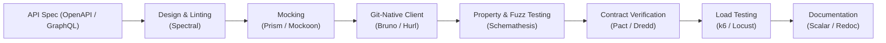

# 🚀 Awesome API Development & Testing

  

  
  
  
  
  
  
  

---

## 📌 Top API Development & Testing Ecosystem

**A curated matrix of world-class SaaS platforms & open-source GitHub projects for REST, GraphQL, gRPC, and WebSocket APIs.**

*Focused on API Client IDEs, Contract Testing, Property-Based Testing, Mock Servers, and Filesystem-First / Git-Native Collaboration.*

📅 **Last updated: October 2026**

This repository provides an authoritative, SEO-indexed technical directory covering the entire **API lifecycle**—from GUI clients with cloud workspace synchronization to offline-first, Git-native IDEs where API definitions live alongside your source code in version control.

### 🔍 Quick Highlights
- **Category Leaders**: Postman, Insomnia, Paw / RapidAPI, SwaggerHub, Stoplight.
- **Git-Native Revolution**: Bruno, Hurl, HTTPie, and VS Code REST Client.
- **Contract & Spec Testing**: Schemathesis, Dredd, Pact, and Spectral.
- **Performance & Mocking**: Grafana k6, Locust, WireMock, Mockoon, and Prism.

---

## 📑 Table of Contents
- [📊 Sector Overview & Market Dynamics](#-sector-overview--market-dynamics)
- [☁️ SaaS / Hosted Platforms](#️-saas--hosted-platforms)
- [💻 Open-Source GitHub Projects](#-open-source-github-projects)
  - [🔥 Tier 1: 30k+ Stars](#-tier-1-30k-stars)
  - [⚡ Tier 2: 10k–30k Stars](#-tier-2-10k30k-stars)
  - [🛠️ Tier 3: 5k–10k Stars](#️-tier-3-5k10k-stars)
  - [🎯 Tier 4: Specialized & Contract Testing (Under 5k Stars)](#-tier-4-specialized--contract-testing-under-5k-stars)
- [🏗️ Architectural Recommendations & Custom Stacks](#️-architectural-recommendations--custom-stacks)
- [🤝 How to Contribute](#-how-to-contribute)
- [⭐ Star History](#-star-history)
- [💖 Support & Sponsorship](#-support--sponsorship)
- [⚖️ Disclaimer](#️-disclaimer)

---

## 📊 Sector Overview & Market Dynamics

The global **API testing market** is valued at approximately **$1.85B to $2.85B** (projected to reach over **$3.2B** with an **18%–21% CAGR**), while the broader **API management ecosystem** is estimated between **$8.6B and $10.0B+**.

The sector exhibits **moderate fragmentation**:
- **Market Dynamics**: While long-standing category incumbents (Postman, SmartBear) dominate enterprise compliance and cloud workspaces, the sector experiences rapid fragmentation driven by **developer privacy demands**, **Git-native architectures**, and **AI-agent test generation**. 
- **Decentralization Trend**: Engineering organizations increasingly reject vendor lock-in and proprietary cloud syncing of sensitive API tokens, fueling explosive growth in local-first clients (`.bru`, `.http`) and consumer-driven contract testing.

---

## ☁️ SaaS / Hosted Platforms

| Platform | Description | Scale (Valuation / Revenue) | Starting Paid Pricing | Free Tier Limits |
| :--- | :--- | :--- | :--- | :--- |
| **[Postman](https://www.postman.com/)** | 🌐 Industry-standard API platform for designing, building, and automated test collections. | **$5.6B valuation** (~$270M ARR) | **$9/user/month** (Solo, billed annually) or **$19/user/month** (Team) | **Free forever plan**: 1 user, unlimited collection runs, unlimited mock servers, and 50 AI credits/month (team collaboration/workspaces require paid plans). |
| **[Insomnia](https://insomnia.rest/)** | ⚡ API client for REST, GraphQL, WebSockets, SSE, and gRPC with design-first spec editing and MCP support. | **$2.0B valuation** (~$145M ARR for Kong Inc.) | **$12/user/month** (Pro, billed annually) | **Free forever plan (Essentials)**: Up to 3 users for Git Sync projects, unlimited local/cloud projects, and 1,000 mock server requests/month. |
| **[SwaggerHub](https://swagger.io/tools/swaggerhub/)** | 📖 Collaborative API design and documentation platform built on OpenAPI specifications. | **$1.8B+ valuation** (~$150M+ revenue for SmartBear) | **$19/user/month** (Individual, billed annually) or **$49/user/month** (Team) | **Free forever plan**: Up to 3 public APIs, 5 reusable domains, 1 public product portal with SmartBear branding, and 10 testing/AI credits. |
| **[Stoplight](https://stoplight.io/)** | 🎨 API design-first platform featuring visual OpenAPI/AsyncAPI editing, mocking (Prism), and style governance. | **$1.8B+ valuation** (Acquired by SmartBear) | **$39/user/month** (Startup/Team tier) | **Free forever plan**: Up to 3 user seats, 1 workspace project, visual design editor, and basic API documentation generation. |
| **[RapidAPI](https://rapidapi.com/)** | 🌍 Global API marketplace and developer hub offering discovery, testing, and monetization across 40k+ APIs. | **$1.0B valuation** (~$40M ARR; Acquired by Nokia) | **$10/user/month** (Team Hub basic seat) | **Free forever plan**: Free account with basic API testing and marketplace access; individual APIs offer free tiers typically capped at 100–500 req/day. |
| **[Paw](https://paw.cloud/)** | 🍏 Native macOS API client with dynamic environments, visual code generation, and team sync. | **$1.0B valuation** (Acquired by RapidAPI / Nokia) | **Free** ($0 for full Mac client; integrated with RapidAPI Studio) | **Free forever plan**: Completely free for personal and commercial usage with full native macOS feature access and local file storage. |
| **[Hoppscotch Cloud](https://hoppscotch.io/)** | 🚀 Managed cloud version of the lightweight, open-source API client for REST, GraphQL, SSE, and WebSockets. | **$3M+ valuation** ($3M Seed funded; ~$1M ARR) | **$6/user/month** (Business, billed annually) | **Free forever plan**: Unlimited personal collections, environments, and multi-protocol testing; team workspaces and shared cloud collaboration require paid plans. |
| **[HTTPie Cloud](https://httpie.io/)** | 💻 Cloud-synced, visual and web client paired with the popular human-friendly command-line HTTP client. | **~$550k ARR** (Boutique / Bootstrapped developer platform) | **$9/user/month** (Team tier, billed annually) | **Free forever plan**: Unlimited local and incognito requests, cross-device cloud sync for personal libraries, and preview access to HTTPie AI. |
| **[Apidog](https://apidog.com/)** | 🔄 Unified platform integrating API design, automated testing, mocking, and documentation with OpenAPI synchronization. | **Bootstrapped** (Private, self-funded startup) | **$9/user/month** (Basic, billed annually) | **Free forever plan**: Up to 4 team members, up to 5 projects, 1 sprint branch per project, and unlimited collection runs / mock servers. |
| **[Thunder Client](https://www.thunderclient.com/)** | ⚡ Lightweight, editor-native REST API client extension for VS Code and JetBrains IDEs. | **Bootstrapped** (Private indie developer tool) | **$3/user/month** (Starter, billed annually) | **Free forever plan**: Free for non-commercial/personal use; limited to basic manual requests (0 automated collection runs, environments/collections limited). |

---

## 💻 Open-Source GitHub Projects

All open-source tools below are strictly ranked in descending order by GitHub Stars ⭐. Each entry includes its real-time star badge linking to the repository's stargazers.

### 🔥 Tier 1: 30k+ Stars

- **[Hoppscotch](https://github.com/hoppscotch/hoppscotch)**   
  **The most widely adopted open-source API request builder** (MIT) . Lightweight web-first UI supporting **REST, GraphQL, WebSocket, SSE, MQTT, and Socket.IO**. Fully self-hostable with Docker for organizations that prioritize data sovereignty.

- **[Bruno](https://github.com/usebruno/bruno)**   
  **The offline-first, Git-native API client revolution** (MIT) . Bruno stores API collections as plain text files (`.bru` format) directly on your filesystem. What Postman Cloud provides via proprietary servers, Bruno delivers through Git—branches, pull requests, code reviews, and history. Features CLI for CI/CD, local `.env` secret management, and zero vendor lock-in.

- **[curl](https://github.com/curl/curl)**   
  **The universal command-line tool for transferring data with URLs** (curl License) . The foundational backbone of network protocols and API testing—supporting HTTP, HTTPS, FTP, FTPS, SCP, SFTP, TFTP, DICT, TELNET, LDAP, and FILE.

- **[Insomnia](https://github.com/Kong/insomnia)**   
  **Open-source desktop API client for REST, GraphQL, gRPC, and WebSockets** (Apache-2.0) . Maintained by Kong, featuring design-first spec editing, environment variables, code generation, and an extensive plugin ecosystem.

- **[HTTPie CLI](https://github.com/httpie/cli)**   
  **Modern, user-friendly command-line HTTP client** (BSD-3-Clause) . Designed for human readability with intuitive syntax, colorized terminal output, formatted JSON support, and persistent sessions.

- **[k6](https://github.com/grafana/k6)**   
  **Modern developer-centric load and performance testing tool** (AGPL-3.0) . Built by Grafana Labs with a Go core and JavaScript test scripting runtime for API stress testing and CI/CD quality gates.

---

### ⚡ Tier 2: 10k–30k Stars

- **[Swagger UI](https://github.com/swagger-api/swagger-ui)**   
  **The industry-standard interactive visual documentation generator for OpenAPI specifications** (Apache-2.0) . Dynamically renders interactive API consoles from OpenAPI definitions without framework constraints.

- **[Locust](https://github.com/locustio/locust)**   
  **Scalable, Python-code-as-configuration load testing framework** (MIT) . Define user behavior in plain Python code and monitor distributed load tests via a clean real-time web dashboard.

- **[OpenAPI Generator](https://github.com/OpenAPITools/openapi-generator)**   
  **Enterprise code generation engine from OpenAPI specs** (Apache-2.0) . Generates client SDKs, server stubs, and configuration files across 50+ programming languages and frameworks.

- **[Redoc](https://github.com/Redocly/redoc)**   
  **Clean, responsive OpenAPI documentation generator** (MIT) . Provides a three-panel design optimized for readable documentation and developer experience with deep markdown and code sample support.

- **[Hurl](https://github.com/Orange-OpenSource/hurl)**   
  **Blazing-fast CLI tool powered by Rust and libcurl** (Apache-2.0) . Runs HTTP requests defined in simple plain text files with built-in assertion testing, HTML/JSON parsing, and seamless CI/CD integration.

- **[Scalar](https://github.com/scalar/scalar)**   
  **Modern, beautifully designed interactive API documentation and testing platform** (MIT) . Offers a responsive OpenAPI reader with integrated live request clients and theme customization.

- **[gRPCurl](https://github.com/fullstorydev/grpcurl)**   
  **The curl of gRPC** (MIT) . Command-line tool for interacting directly with gRPC servers, supporting reflection and protobuf schema parsing.

---

### 🛠️ Tier 3: 5k–10k Stars

- **[BloomRPC](https://github.com/bloomrpc/bloomrpc)**   
  **Desktop GUI client for gRPC and Protocol Buffers services** (MIT) . Provides a visual workspace for testing unary, client-streaming, and bidirectional gRPC calls.

- **[Mockoon](https://github.com/mockoon/mockoon)**   
  **Fastest and easiest local mock server application** (MIT) . Standalone desktop and CLI tool with route generation, templating, proxy mode, and zero cloud dependency.

- **[WireMock](https://github.com/wiremock/wiremock)**   
  **Enterprise-grade simulator for HTTP-based APIs** (Apache-2.0) . Enables stubbing, fault injection, dynamic responses, stateful scenarios, and verification in Java and containerized test setups.

- **[Newman](https://github.com/postmanlabs/newman)**   
  **Postman's official command-line collection runner** (Apache-2.0) . Allows running Postman test suites directly inside CI/CD pipelines with JUnit, HTML, and JSON reporter exports.

- **[REST Client (VS Code)](https://github.com/Huachao/vscode-restclient)**   
  **Popular in-editor HTTP request runner for VS Code** (MIT) . Send requests and view responses directly within `.http` and `.rest` text files without leaving your IDE.

- **[grpc-ui](https://github.com/fullstorydev/grpcui)**   
  **Interactive web UI for exploring and testing gRPC services** (MIT) . Provides an in-browser form-based GUI built on top of gRPCurl reflection.

- **[Prism](https://github.com/stoplightio/prism)**   
  **Open-source HTTP mock server and contract linter** (Apache-2.0) . Generates dynamic realistic mock responses on the fly based directly on OpenAPI specifications.

---

### 🎯 Tier 4: Specialized & Contract Testing (Under 5k Stars)

- **[MockServer](https://github.com/mock-server/mockserver-monorepo)**   
  **Rich HTTP and HTTPS mocking and proxy framework** (Apache-2.0) . Verifies incoming requests, records traffic, and mocks microservice dependencies in integration test environments.

- **[Dredd](https://github.com/apiaryio/dredd)**   
  **Language-agnostic HTTP API contract verification tool** (MIT) . Automatically tests live API implementations against OpenAPI/Swagger specs to prevent documentation drift.

- **[Schemathesis](https://github.com/schemathesis/schemathesis)**   
  **State-of-the-art property-based testing tool** (MIT) . Employs hypothesis-driven fuzzing against OpenAPI and GraphQL schemas to automatically detect server crashes, uncaught exceptions, and specification breaches.

- **[kin-openapi](https://github.com/getkin/kin-openapi)**   
  **Go package for OpenAPI 3.0/3.1 validation, serialization, and request/response inspection** (MIT) . Widely adopted for building custom microservice gateways and validation middlewares.

- **[Spectral](https://github.com/stoplightio/spectral)**   
  **Flexible JSON/YAML and OpenAPI linter** (Apache-2.0) . Enforces style guides, naming standards, and architectural consistency across all enterprise API specifications.

- **[Pact JS](https://github.com/pact-foundation/pact-js)**   
  **Consumer-driven contract testing framework** (MIT) . Enables independent deployment of microservices with absolute confidence that breaking contract changes will be caught before production.

- **[SpectaQL](https://github.com/anvilco/spectaql)**   
  **Autogenerated static documentation for GraphQL schemas** (MIT) . Produces beautiful, three-panel static API documentation directly from any GraphQL schema.

---

## 🏗️ Architectural Recommendations & Custom Stacks

Modern enterprise engineering organizations are shifting away from centralized proprietary clouds. A recommended open-source, vendor-independent API development stack includes:

1. **Git-Native Core**: Use **[Bruno](https://github.com/usebruno/bruno)** for manual exploration and local test execution. Collections are stored as text files alongside codebase pull requests.
2. **Automated CI/CD Execution**: Use **[Hurl](https://github.com/Orange-OpenSource/hurl)** or **[Newman](https://github.com/postmanlabs/newman)** for regression assertions in automated pipelines.
3. **Spec Fuzzing**: Integrate **[Schemathesis](https://github.com/schemathesis/schemathesis)** to automatically discover 500-level errors and unhandled exceptions that human-authored tests miss.
4. **Contract Isolation**: Deploy **[Pact](https://github.com/pact-foundation/pact-js)** to guarantee that consumers and providers do not break contracts during independent deployments.
5. **Load Performance**: Run **[k6](https://github.com/grafana/k6)** test suites against staging environments prior to every release.

---

## 🤝 How to Contribute

Contributions are warmly welcomed! Help keep this matrix accurate, complete, and useful to the community:

1. **Fork the repository** on GitHub.
2. **Add or update an entry** in `README.md` following the existing format.
3. **Requirements for entries**:
   - For SaaS products: Must provide specific pricing and exact free tier limitations.
   - For open-source tools: Must provide repository link, license, and brief description.
4. **Submit a pull request** with a concise explanation of your addition.

---

## ⭐ Star History

---

## 💖 Support & Sponsorship

If you find this repository valuable for your daily engineering workflow, API design, or platform architecture:

- ⭐ **Star this repository** to help other developers discover it!
- 🍴 **Fork and share** it with your team, platform engineers, and developer communities.
- ☕ **Support the maintainer**: Buy a coffee or become a recurring sponsor via the [GitHub Sponsor Dashboard](https://github.com/sponsors/ishandutta2007).

Thank you for your generous support in keeping open-source documentation independent, accurate, and up-to-date! 🙏

---

## ⚖️ Disclaimer

- This is an independent, **community-curated directory** intended for educational, research, and technical evaluation purposes.
- Any trademarks, logos, and brand names belong to their respective owners.
- Security reminder: When working with API clients, always enforce local secret management (e.g., `.env` files added to `.gitignore`) and never commit real API tokens, keys, or credentials into source control repositories.

---

  <b>Built with ❤️ for the global API developer community.</b> 
  Let's make API development and testing transparent, robust, and Git-native!

